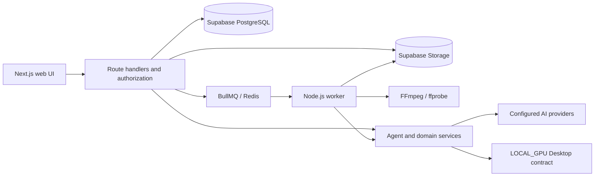

# EmberOS

EmberOS is a private, multi-tenant marketing production system developed by EmberSoul Labs. It combines campaign and asset management, structured marketing generation, automated short-video production, Photo Scene composition, and a campaign-owned AI Story workflow behind workspace-scoped authorization and human review.

This repository is the canonical monorepo for the web application, background worker, domain services, database contracts, queue contracts, tests, and release documentation. Source-code reachability does not by itself prove that a feature is enabled or deployed in Production; see [Release status](#release-status).

## Capability status

### Implemented in the repository

- Organization, workspace, membership, and role-scoped access control.
- Workspace Asset Library with signed upload, confirmation, preview, download, attachment, and isolation flows.
- Business Profile and campaign creation/workspace flows.
- Campaign marketing plans, creative handoffs, review records, structured marketing packages, translation, and approved Social Content drafts.
- Video Studio V1 bounded auto-clip pipeline: source analysis, copy/edit planning, FFmpeg rendering, review, private artifact delivery, and export.
- Photo Scene V1: product extraction, official-scene selection, deterministic composition, durable generation records, signed delivery, retry, and campaign asset binding.
- AI Story planning and execution contracts, including story revisions, canonical Scenes, Director and Motion plans, Character/Product authority, Character DNA, descriptive Voice DNA authority, pre-generation QC, scene scheduling, provider attempts, human review, Post-QC, assembly, and Final Story Result projection.
- Provider-neutral routing, commercial authorization, budget/claim records, idempotency, outbox processing, and settlement controls.
- LOCAL_GPU V2/V3 package transport for asset-based R2V and zero-asset T2V, including signed requests, reference hashes, upload bindings, deterministic H3 prompt serialization, and fail-closed capability checks.
- Super Admin control-plane and runtime diagnostics.
- Supabase PostgreSQL RLS and workspace-scoped data-access tests.

### In progress or release-gated

- AI Story Self-Use V1 is implemented and has a bounded deployment record, but the repository release authority still classifies it as `DEPLOYED / AWAITING REAL EPISODE CERT`. It is not a public commercial release.
- LOCAL_GPU Character DNA + optional descriptive Voice DNA + Scene R2V support exists in the Laptop contract. Individual Desktop workflows must advertise and enforce the required Contract V3 capabilities before dispatch.
- Several AI Story runtime capabilities are environment-, model-, authority-, and budget-gated. A route existing in source does not mean that a provider is configured or authorized.
- Current main contains work newer than the last bounded Production overlay. Full-main deployment is not implied or recommended by this README.

### Blocked or deliberately unsupported

- Exact acoustic voice cloning/continuity is not claimed. Voice DNA is descriptive and capability-bound; unsupported audio requirements fail closed.
- AI Story raw-video observation extraction and its upload/Director integration remain explicitly marked `NOT_IMPLEMENTED` in the current contracts.
- Provider callbacks and provider-native idempotency are unsupported for the current Seedance and MiniMax V1 adapters; replay protection is implemented within EmberOS.
- AI Story execution can be blocked by missing authorization, stale approvals, failed Pre-QC, unsupported continuity/audio requirements, absent provider capability, or cost ceilings.
- Public commercial AI Story access and the separate AUTH-01 commercial cutover remain release-gated.

### Planned or outside the current release boundary

- Direct social-platform OAuth publishing, scheduling, and analytics feedback loops.
- Studio-mode long-form editing, advanced rhythm editing, and a general-purpose timeline editor.
- Broader SaaS billing/plan rollout and quota activation.
- Automated media-aware QC beyond the currently certified plan/intent checks plus mandatory human generated-media review.

## Architecture



Key boundaries:

- `apps/web` owns the Next.js UI, authenticated route handlers, signed delivery, and product-facing runtime views.
- `apps/worker` consumes BullMQ jobs, runs media processing, provider execution/finalization, assembly, and operational heartbeats.
- `packages/agents` contains orchestration, provider adapters, AI Story compilation/QC, marketing generation, Photo Scene, and media-domain services.
- `packages/db` owns the Drizzle schema, scoped queries, additive SQL contracts, and migration/apply scripts.
- `packages/queue` defines queue names and typed job payloads.
- `packages/shared` contains provider-neutral schemas, runtime contracts, authorization facts, and shared UI/domain types.
- PostgreSQL rows, immutable fingerprints, approvals, provider claims, and workspace bindings are authoritative. Prompt text does not replace deterministic constraints.

## Technology stack

| Area | Implementation |
| --- | --- |
| Web | Next.js 14 App Router, React 18, TypeScript, Tailwind CSS |
| API | Next.js Route Handlers with Supabase authentication and workspace authorization |
| Data | PostgreSQL, Drizzle ORM, SQL migrations/contracts, Row Level Security |
| Authentication and storage | Supabase Auth and Supabase Storage |
| Queue | BullMQ with Redis-compatible infrastructure |
| Worker/media | Node.js worker, FFmpeg, ffprobe |
| Validation | Zod schemas and deterministic fingerprints |
| AI/provider integration | OpenAI plus gated Seedance, MiniMax, and LOCAL_GPU adapters |
| Tests | Vitest, Playwright, ephemeral PostgreSQL integration tests |
| Deployment manifests | Vercel for web; Railway Docker worker |

## Repository layout

```text
EmberOS/
├── apps/
│   ├── web/                 # Next.js UI and API routes
│   └── worker/              # BullMQ consumers and media/provider runtime
├── packages/
│   ├── agents/              # Orchestration and domain/provider services
│   ├── db/                  # Schema, scoped queries, SQL, and apply scripts
│   ├── queue/               # Typed queues and job contracts
│   └── shared/              # Shared schemas, contracts, and constants
├── supabase/migrations/     # Forward Supabase migrations
├── schemas/                 # Versioned external/runtime schemas
├── tests/                   # Unit, contract, security, and integration tests
├── e2e/                     # Playwright browser coverage
├── scripts/                 # Verification, smoke, and guarded operator tools
├── infra/docker/            # Worker container definition
├── docs/                    # Architecture, product, release, and review evidence
└── .github/workflows/       # CI definition
```

## Local development

### Prerequisites

- Node.js 20 or later.
- pnpm 9.15.0, matching the root `packageManager` declaration.
- PostgreSQL and Redis for database-, queue-, and worker-backed flows.
- FFmpeg and ffprobe on `PATH` for media processing.
- A development Supabase project for authenticated UI, Storage, and RLS flows.
- Provider credentials only for the specific provider-backed flow being exercised. Most unit and contract tests use injected deterministic adapters and do not require paid calls.

### Install and configure

```bash
git clone https://github.com/EmbersoulLabs/EmberOS.git
cd EmberOS
pnpm install --frozen-lockfile
cp .env.example .env.local
pnpm dev:sync
```

`pnpm dev:sync` copies the root environment file to the web and worker locations used by local scripts. Review the target files before using shared or remote infrastructure. If local development points at a shared Redis instance, set `LOCAL_DEV` and an isolated `BULLMQ_PREFIX`.

### Start services

```bash
# Run all Turbo development tasks
pnpm dev

# Run only the worker in another terminal when needed
pnpm worker:dev
```

The web package listens on `http://localhost:3000` by default. Database-backed and authenticated pages require the configured development infrastructure; a successful Next.js startup alone does not certify those dependencies.

### Database safety

The repository exposes `db:generate`, `db:push`, `db:migrate`, and many feature-specific `sql:*` scripts. These commands mutate the database selected by `DATABASE_URL`; they are not part of the default bootstrap sequence. Use only a disposable or explicitly authorized environment, read the corresponding apply script, and run integration tests before any shared-environment rollout. Never rewrite an applied migration.

## Environment variables

Names below are taken from `.env.example` and current runtime configuration. Values and secrets must not be committed.

### Core web, database, storage, and queue

- `NEXT_PUBLIC_APP_URL`
- `NEXT_PUBLIC_SUPABASE_URL`
- `NEXT_PUBLIC_SUPABASE_ANON_KEY`
- `SUPABASE_SERVICE_ROLE_KEY`
- `DATABASE_URL`
- `REDIS_URL`
- `SUPABASE_STORAGE_BUCKET`
- `SUPABASE_BRANDING_BUCKET`
- `SUPERADMIN_EMAILS`
- `EXPORT_PAYWALL`
- `NEXT_PUBLIC_EXPORT_PAYWALL`

### Worker and local isolation

- `FFMPEG_PATH`
- `FFPROBE_PATH`
- `WORKER_CONCURRENCY`
- `RENDER_CONCURRENCY`
- `LOCAL_DEV`
- `BULLMQ_PREFIX`
- `AGENT_JOB_LOCK_MS`
- `RENDER_JOB_LOCK_MS`

### Provider integrations

- `OPENAI_API_KEY`
- `AI_PROVIDER_SEEDANCE_ENABLED`
- `AI_PROVIDER_SEEDANCE_BASE_URL`
- `AI_PROVIDER_SEEDANCE_API_KEY`
- `AI_PROVIDER_SEEDANCE_DEFAULT_MODEL`
- `AI_PROVIDER_MINIMAX_ENABLED`
- `AI_PROVIDER_MINIMAX_BASE_URL`
- `AI_PROVIDER_MINIMAX_API_KEY`
- `AI_PROVIDER_MINIMAX_DEFAULT_MODEL`
- `LOCAL_GPU_ENVIRONMENT`
- `AI_STORY_PROVIDER_DISPATCH_MODE`
- `JAMENDO_CLIENT_ID`
- `PHOTO_SCENE_BACKGROUND_REMOVAL_PROVIDER`
- `PHOTOROOM_API_KEY`
- `PHOTO_SCENE_PHOTOROOM_COST_USD`
- `PHOTO_SCENE_PROVIDER_TIMEOUT_MS`
- `PHOTO_SCENE_ALLOW_DETERMINISTIC_PROVIDER`
- `PHOTO_SCENE_OFFICIAL_BUCKET`

### Cost and retry controls

- `LLM_BUDGET_PER_TASK_USD`
- `CEO_MAX_RETRIES`
- `PROVIDER_EXECUTION_POLL_MS`
- `EMBEROS_AI_STORY_LOOKUP_DEADLINE_MS`
- `EMBEROS_AI_STORY_LOOKUP_POLL_MS`

Migration acknowledgements, certification identifiers, E2E seeds, and production-operator flags also exist under `scripts/`. They are intentionally omitted from normal setup because they are guarded operational inputs, not routine application configuration.

## Validation and development workflow

Use a branch or isolated worktree and preserve unrelated local changes. The standard offline verification command is:

```bash
pnpm verify
```

It runs the root Vitest suite, all package typechecks, and the web production build. Useful narrower commands are:

```bash
pnpm test
pnpm typecheck
pnpm --filter @ceo-agent/worker typecheck
pnpm --filter @ceo-agent/web build
pnpm test:auth-browser
```

Database tests must target an isolated database:

```bash
pnpm test:integration
```

The test runner requires explicit test-environment markers and contains guards against known Production database targets. Do not weaken those guards.

See [DEVELOPMENT_WORKFLOW.md](./DEVELOPMENT_WORKFLOW.md) and [docs/DEVELOPMENT-RULES.md](./docs/DEVELOPMENT-RULES.md) for contribution and migration rules.

## CI/CD and deployment

`.github/workflows/ci.yml` runs on pull requests and pushes to `main`, `master`, and `codex/**` branches. Required coverage includes:

- dependency installation with the lockfile;
- unit and LOCAL_GPU contract tests;
- browser tests for authentication and Waves 1–5;
- monorepo typecheck, worker compile, and web build;
- an ephemeral PostgreSQL authority suite with migration guards;
- a local `/api/health` smoke test backed by disposable PostgreSQL and Redis services.

The Production E2E job is manual (`workflow_dispatch`) and uses configured secrets. It may reach external infrastructure and must not be treated as an ordinary PR check.

Deployment configuration present in the repository:

- Root `vercel.json` and `apps/web/vercel.json` build `@ceo-agent/web` for Vercel.
- `railway.toml` builds `infra/docker/Dockerfile.worker` and starts `@ceo-agent/worker` on Railway.
- Production database changes use separately reviewed, ordered, additive migrations/apply scripts.

Deployments are release operations, not a side effect of the documented local commands. Use the bounded release instructions for the product being changed; do not deploy full main merely because CI passes.

## External services

| Service | Purpose | Notes |
| --- | --- | --- |
| Supabase | PostgreSQL, authentication, private/public buckets, signed delivery | Workspace RLS and service-role boundaries are security-critical. |
| Redis-compatible service | BullMQ queues and worker coordination | Local/shared prefixes must be isolated. |
| OpenAI | Structured text/vision, selected image, transcription, and TTS adapters | Paid execution requires an authorized runtime claim. |
| BytePlus Seedance | Gated AI Story video provider | Disabled unless explicitly configured and authorized. |
| MiniMax | Gated AI Story video provider | Capability-specific; callbacks are not used. |
| LOCAL_GPU Desktop | Local H3 R2V/T2V execution over signed V2/V3 contracts | The normal local video path; capability mismatch fails closed. |
| Photoroom | Photo Scene background removal | Deterministic fallback is prohibited in Production. |
| Jamendo | Optional online music search | UI search is hidden when unconfigured. |
| Vercel / Railway | Web and worker deployment targets | Live revision must be verified independently for an operational claim. |

## Release status

The repository's release authority is [RELEASE_CHANNEL.md](./RELEASE_CHANNEL.md). At its last recorded update:

| Capability | Recorded status |
| --- | --- |
| Video Studio V1 | Released and frozen as a bounded production assembly |
| Photo Scene V1 | Released and frozen as a bounded production assembly |
| AI Story Self-Use V1 | Deployed, awaiting complete real-episode certification; not publicly released |
| AI Story public commercial release | No |
| Full current `main` | Not established as the Production revision |

Those are repository records, not a live environment probe. Current Production and Staging SHAs, worker health, database migration state, provider configuration, and feature flags are **unknown until read from their respective deployment systems**.

Staging, preview, local, certification, and Production authorities are intentionally separate. Production-only scripts require explicit target checks and acknowledgement flags. Never use customer campaigns or Production records for routine development tests.

## Known limitations and operational notes

- `/api/health` reports web/runtime readiness; Redis queue depth is intentionally non-fatal to basic web health. Use worker logs and queue diagnostics for worker certification.
- The asset bucket is private in the recorded bounded release. Persist canonical storage identities and deliver artifacts through authorized signed routes rather than storing expiring provider URLs as authority.
- A Local GPU workflow ID alone does not prove Character DNA, Voice DNA, continuity, audio, or first-frame support. The advertised capability block and authority binding must match the request.
- `UNKNOWN` provider outcomes are reconciliation states and must not automatically trigger a second paid call.
- Human approval, immutable fingerprints, provider attempts, workspace scope, and commercial claims must survive retries and replay.
- Some older planning documents describe superseded product targets. Prefer executable contracts, current tests, `RELEASE_CHANNEL.md`, and the newest bounded release evidence.
- The optional Production E2E and provider quality checks may incur costs or create records. They require separate authorization and are not run by `pnpm verify`.

## Troubleshooting

| Symptom | Checks |
| --- | --- |
| Web starts but authenticated pages fail | Verify Supabase public variables, service-role server configuration, database reachability, and the expected local migration state. |
| Jobs remain queued | Verify Redis connectivity, `BULLMQ_PREFIX`, worker process health, queue registration, and that web and worker use compatible contracts. |
| FFmpeg render fails | Run `ffmpeg -version` and `ffprobe -version`; verify `FFMPEG_PATH`, `FFPROBE_PATH`, codecs, fonts, and worker filesystem permissions. |
| Upload or playback fails | Verify bucket visibility, canonical storage path, service-role access, signed URL generation, and workspace authorization. |
| Provider dispatch is blocked | Inspect Pre-QC, approval freshness, provider capability, runtime authorization, budget ceiling, and environment-specific provider enablement. Do not bypass the gate or add an automatic fallback. |
| LOCAL_GPU request is rejected | Compare V2/V3 contract version, signature, timestamp, workflow capability, reference hashes, upload binding, and Desktop active worker version. |
| Integration tests refuse to run | Use a disposable PostgreSQL instance and the required test markers; do not point the suite at Production. |

## Further documentation

- [Release channel](./RELEASE_CHANNEL.md)
- [AI Story V1](./docs/AI_STORY_V1.md)
- [AI Story execution](./docs/AI_STORY_EXECUTION_V1.md)
- [LOCAL_GPU DNA/R2V Desktop handoff](./docs/releases/local-gpu-dna-r2v-desktop-handoff.md)
- [Video Studio V1 release roadmap](./docs/releases/video-studio-v1-release-roadmap.md)
- [Photo Scene V1 architecture](./docs/architecture/photo-scene-v1.md)
- [Hybrid migration authority and guards](./docs/architecture/EMBEROS-HYBRID-MIGRATION-AUTHORITY-AND-GUARDS.md)
- [Canonical AI Story RLS](./docs/architecture/ai-story-canonical-rls.md)
- [Agency onboarding](./docs/AGENCY_ONBOARDING.md)

## License

Private repository. No public license is granted.
